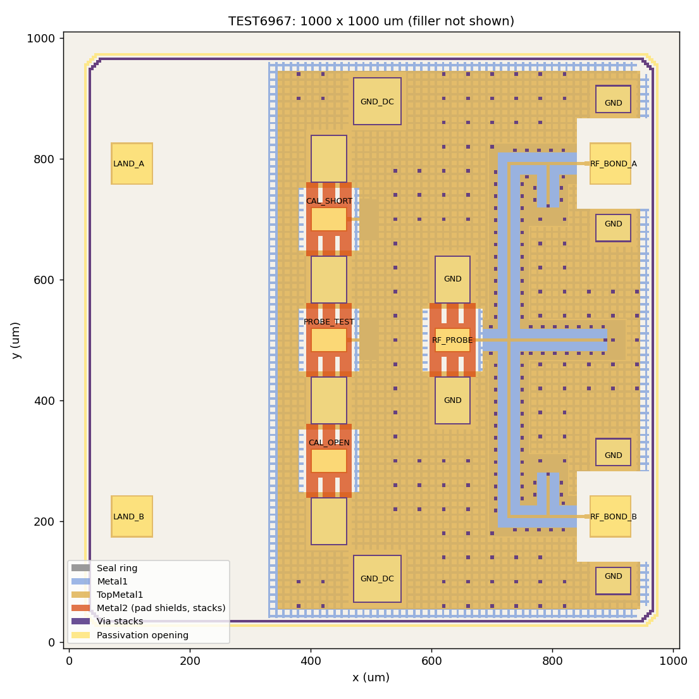

# IHP__TEST6967: 130-GHz Passive Test Chip in IHP SG13CMOS5L

Chip design data for the IHP Open-Silicon MPW run Nov-2026 (SG13CMOS5L, run 877). The chip is purely passive
(no devices, no supply). Layout and verification were made with open-source tools (IHP-Open-PDK, KLayout, Magic).

| | |
|---|---|
| Top cell | `TEST6967` |
| Category | Analog / TEST (test and characterisation structure) |
| Die size | 1000 x 1000 um (1.0 mm²), seal ring and filler included |
| Technology | IHP SG13CMOS5L (Metal1 ... TopMetal1), IHP-Open-PDK `c6562037` |
| Frequency range | D-band, centre 130 GHz |
| Release | [`release/v.1.0.0/gds/TEST6967.gds`](release/v.1.0.0/gds/TEST6967.gds), SHA-256 in [`SHA256SUMS`](release/v.1.0.0/gds/SHA256SUMS) |
| Sign-off | [`release/v.1.0.0/doc/Signoff.md`](release/v.1.0.0/doc/Signoff.md) |

## Structures

- **RF_PROBE**: GSG probe pad (100-um pitch) in the chip centre, probed from the left (-x).
- **On-chip network**: TopMetal1 lines over Metal1 ground from RF_PROBE to the two RF pads **RF_BOND_A** and
  **RF_BOND_B** at the right chip edge, each with two ground pads.
- **Calibration structures** at the left chip edge, GSG with 100-um pitch, probed from the left: **CAL_OPEN**,
  **CAL_SHORT** and **CAL_LINE150** (150-um line, shorted). They use the same pad geometry as RF_PROBE.
- **GND_DC**: two ground pads (top and bottom).
- Ground: TopMetal1 plate with slits, Metal1 grid below, via stacks Metal1 to TopMetal1 on a 40-um grid.

Pad positions and sizes: [doc/Datasheet.md](doc/Datasheet.md).

## Repository contents

| Path | Content |
|---|---|
| `doc/` | `info.json`, specification, datasheet, TRL self-assessment, layout figure |
| `release/v.1.0.0/gds/` | final GDS (seal ring and filler included) and checksum |
| `release/v.1.0.0/netlist/` | LVS netlist (empty subcircuit: the chip has no devices) |
| `release/v.1.0.0/doc/` | DRC and LVS logs and result databases, sign-off summary |
| `measurements/v.1.0.0/` | measurement results (after fabrication) |
| `TEST6967-main/` | notes on the top cell |
| `dependencies/` | none |
| `.github/workflows/` | workflow-sync template of Open-Silicon-MPW, as created by `gen_structure.py` |

## License

Apache License 2.0, see [LICENSE](LICENSE).

## Author

Gianluca Simone, Institute for Smart Electronics and Systems (LITES), Friedrich-Alexander-Universität
Erlangen-Nürnberg (FAU), Germany.
