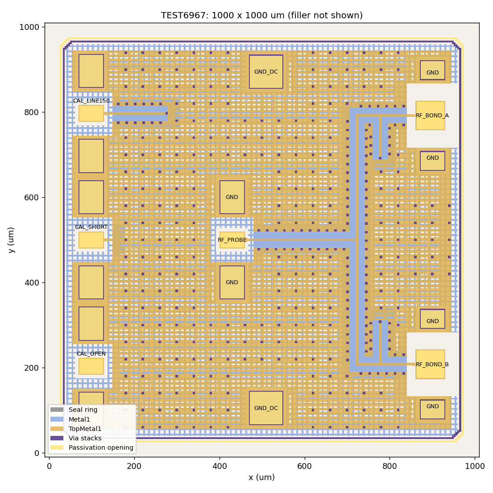

# TEST6967 Datasheet

Purely passive 130-GHz test chip, 1000 x 1000 um, IHP SG13CMOS5L. No supply and no bias; all structures are
measured with RF probes.

## Structures

| Structure | Description |
|---|---|
| RF_PROBE | GSG probe pad, 100-um pitch, chip centre, probed from the left (-x) |
| On-chip network | TopMetal1 lines over Metal1 ground from RF_PROBE to RF_BOND_A and RF_BOND_B |
| RF_BOND_A, RF_BOND_B | RF pads at the right chip edge, each with two ground pads |
| CAL_OPEN | GSG pad, open (same pad geometry as RF_PROBE) |
| CAL_SHORT | GSG pad, short (same pad geometry as RF_PROBE) |
| CAL_LINE150 | GSG pad with 150-um line, shorted at the end |
| GND_DC | two ground pads (top and bottom) |
| Ground | TopMetal1 plate with slits, Metal1 grid below, via stacks Metal1 to TopMetal1 on a 40-um grid |

## Pads

Chip coordinates in um, origin at the lower left corner of the die (seal ring included). Centre and size are
those of the passivation opening.

| Pad | Centre | Passivation opening |
|---|---|---|
| RF_PROBE (S) | (429.82, 500.00) | 55.8 x 35.8 |
| RF_PROBE GND (2x) | (429.82, 400.00), (429.82, 600.00) | 55.8 x 75.8 |
| CAL_OPEN (S) | (99.18, 203.00) | 55.8 x 35.8 |
| CAL_SHORT (S) | (99.18, 500.00) | 55.8 x 35.8 |
| CAL_LINE150 (S) | (99.18, 797.00) | 55.8 x 35.8 |
| CAL GND (6x) | (99.18, 103 / 303 / 400 / 600 / 697 / 897) | 55.8 x 75.8 |
| RF_BOND_A (S) | (895.82, 792.00) | 65.0 x 65.0 |
| RF_BOND_B (S) | (895.82, 208.00) | 65.0 x 65.0 |
| RF_BOND GND (4x) | (900.82, 101.5 / 314.5 / 685.5 / 898.5) | 55.0 x 42.0 |
| GND_DC (2x) | (510.00, 105.00), (510.00, 895.00) | 75.8 x 75.8 |

Pin labels are on TopMetal1 pin (126/25).

